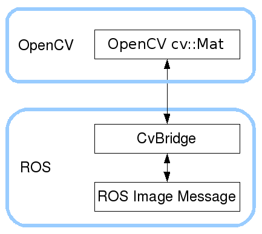
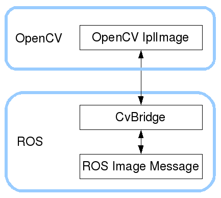

To learn how to interface OpenCV with ROS using !CvBridge, please see
the [tutorials page](#tutorials).


## Tutorials

- [Converting between ROS images and OpenCV images (Android Java)](#converting-between-ros-images-and-opencv-images-android-java):
  This tutorial describes how to interface ROS and OpenCV by converting
  ROS images into OpenCV images, and vice versa, using cv_bridge.
  Included is a sample node that can be used as a template for your own
  node.
- [Converting between ROS images and OpenCV images (Python)](#converting-between-ros-images-and-opencv-images-python):
  This tutorial describes how to interface ROS and OpenCV by converting
  ROS images into OpenCV images, and vice versa, using cv_bridge.
  Included is a sample node that can be used as a template for your own
  node.
- [Converting between ROS images and OpenCV images (C++)](#converting-between-ros-images-and-opencv-images-c):
  This tutorial describes how to interface ROS and OpenCV by converting
  ROS images into OpenCV images, and vice versa, using cv_bridge.
  Included is a sample node that can be used as a template for your own
  node.

## Converting between ROS images and OpenCV images (Android Java)

- **Description:** This tutorial describes how to interface ROS and
  OpenCV by converting ROS images into OpenCV images, and vice versa,
  using cv_bridge. Included is a sample node that can be used as a
  template for your own node.
- **Keywords:** image, images, OpenCV, cvbridge, !CvBridge, Java,
  Android
- **Tutorial Level:** INTERMEDIATE

### TODO:

TODO: Need to compleate this tutorial and documentation in github code.

github = <https://github.com/talregev/android_cv_bridge>

### Concepts

ROS passes around images in its own
[sensor_msgs/msg/Image](https://docs.ros.org/en/rolling/p/sensor_msgs/msg/Image.html)
message format, but many users will want to use images in conjunction
with OpenCV. `CvBridge` is a ROS library that provides an interface
between ROS and OpenCV. `CvBridge` can be found in the
cv_bridge package in the
[vision_opencv](https://index.ros.org/p/vision_opencv) stack.

In this tutorial, you will learn how to write a node that uses
`CvBridge` to convert ROS images into OpenCV
[Java API](hhttp://docs.opencv.org/java/2.4.11/) format.

You will also learn how to convert OpenCV images to ROS format to be
published over ROS.



### Converting ROS image messages to OpenCV images

To convert a ROS image message into an `IplImage`, module
`cv_bridge.CvBridge` provides the following function:


```java
CvImage cv_image = CvImage.toCvCopy(image_message, desired_encoding="passthrough");
```

 The input is the image message, as well as an
optional `encoding`. The encoding refers to the destination
`IplImage` image.

If the default value of "passthrough" is given, the destination image
encoding will be the same as the image message encoding. Image encodings
can be any one of the following OpenCV image encodings:

- 8UC\[1-4\]
- 8SC\[1-4\]
- 16UC\[1-4\]
- 16SC\[1-4\]
- 32SC\[1-4\]
- 32FC\[1-4\]
- 64FC\[1-4\]

For popular image encodings, `CvBridge` will optionally **do color or
pixel depth conversions as necessary**. To use this feature, specify the
`encoding` to be one of the following strings:

- `mono8`: `CV_8UC1`, grayscale image
- `mono16`: `CV_16UC1`, 16-bit grayscale image
- `bgr8`: `CV_8UC3`, color image with blue-green-red color order
- `rgb8`: `CV_8UC3`, color image with red-green-blue color order
- `bgra8`: `CV_8UC4`, BGR color image with an alpha channel
- `rgba8`: `CV_8UC4`, RGB color image with an alpha channel

Note that `mono8` and `bgr8` are the two image encodings expected by
most OpenCV functions.

### Converting OpenCV images to ROS image messages

To convert an `IplImage` into a ROS image message, `CvBridge`
provides the following function:


```java
CvImage cvImage = new CvImage(cv_image, encoding="passthrough");
image_message = cvImage.toImageMsg(empty_ros_image_msg);
```

 The use of "encoding" is slightly more
complicated in this case. It does, as before, refer to the !IplImage.
However, `cv2_to_imgmsg()` does not do any conversions for you (use
[CvtColor](http://opencv.willowgarage.com/documentation/python/miscellaneous_image_transformations.html#CvtColor)
and
[ConvertScale](http://opencv.willowgarage.com/documentation/python/core_operations_on_arrays.html#ConvertScale)
instead). The ROS image message must always have the same number of
channels and pixel depth as the `IplImage`. However, the special
commonly used image formats above (bgr8, rgb8, etc.) will insert
information into the image message about the channel ordering. In this
way, future consumers will know whether the image they receive is RGB or
BGR.

### An example ROS node

Here is a node that listens to a ROS image message topic, converts the
images into an !IplImage, draws a circle on it and displays the image
using OpenCV. The image is then republished over ROS.

In your manifest (or when you use
[roscreate-pkg](https://index.ros.org/p/roscreate)), add the following
dependencies:


```
sensor_msgs
opencv2
cv_bridge
rospy
std_msgs
```

 

```java
/*
 * Copyright (c) 2015, Tal Regev
 * All rights reserved.
 *
 * Redistribution and use in source and binary forms, with or without
 * modification, are permitted provided that the following conditions are met:
 *
 *     * Redistributions of source code must retain the above copyright
 *       notice, this list of conditions and the following disclaimer.
 *     * Redistributions in binary form must reproduce the above copyright
 *       notice, this list of conditions and the following disclaimer in the
 *       documentation and/or other materials provided with the distribution.
 *     * Neither the name of the Android Sensors Driver nor the names of its
 *       contributors may be used to endorse or promote products derived from
 *       this software without specific prior written permission.
 *
 * THIS SOFTWARE IS PROVIDED BY THE COPYRIGHT HOLDERS AND CONTRIBUTORS "AS IS"
 * AND ANY EXPRESS OR IMPLIED WARRANTIES, INCLUDING, BUT NOT LIMITED TO, THE
 * IMPLIED WARRANTIES OF MERCHANTABILITY AND FITNESS FOR A PARTICULAR PURPOSE
 * ARE DISCLAIMED. IN NO EVENT SHALL THE COPYRIGHT OWNER OR CONTRIBUTORS BE
 * LIABLE FOR ANY DIRECT, INDIRECT, INCIDENTAL, SPECIAL, EXEMPLARY, OR
 * CONSEQUENTIAL DAMAGES (INCLUDING, BUT NOT LIMITED TO, PROCUREMENT OF
 * SUBSTITUTE GOODS OR SERVICES; LOSS OF USE, DATA, OR PROFITS; OR BUSINESS
 * INTERRUPTION) HOWEVER CAUSED AND ON ANY THEORY OF LIABILITY, WHETHER IN
 * CONTRACT, STRICT LIABILITY, OR TORT (INCLUDING NEGLIGENCE OR OTHERWISE)
 * ARISING IN ANY WAY OUT OF THE USE OF THIS SOFTWARE, EVEN IF ADVISED OF THE
 * POSSIBILITY OF SUCH DAMAGE.
 */

package org.ros.android.android_tutorial_cv_bridge;

import android.os.Bundle;
import android.util.Log;
import android.view.WindowManager;

import org.opencv.android.BaseLoaderCallback;
import org.opencv.android.LoaderCallbackInterface;
import org.opencv.android.OpenCVLoader;
import org.opencv.core.Core;
import org.opencv.core.Point;
import org.opencv.core.Scalar;
import org.ros.android.RosActivity;
import org.ros.message.MessageListener;
import org.ros.namespace.GraphName;
import org.ros.node.ConnectedNode;
import org.ros.node.Node;
import org.ros.node.NodeConfiguration;
import org.ros.node.NodeMain;
import org.ros.node.NodeMainExecutor;
import org.ros.node.topic.Publisher;
import org.ros.node.topic.Subscriber;

import java.io.IOException;

import cv_bridge.CvImage;
import sensor_msgs.Image;


/**
 * @author Tal Regev
 */
public class MainActivity extends RosActivity implements NodeMain{

    protected Publisher<Image> imagePublisher;
    protected Subscriber<Image> imageSubscriber;
    protected ConnectedNode node;
    protected static final String TAG = "cv_bridge Tutorial";
    protected boolean isInit = false;


    public MainActivity() {
        // The RosActivity constructor configures the notification title and ticker
        // messages.
        super("cv_bridge Tutorial", "cv_bridge Tutorial");
    }

    @SuppressWarnings("unchecked")
    @Override
    public void onCreate(Bundle savedInstanceState) {
        super.onCreate(savedInstanceState);
        getWindow().addFlags(WindowManager.LayoutParams.FLAG_KEEP_SCREEN_ON);
        setContentView(R.layout.main);
    }

    @Override
    protected void init(NodeMainExecutor nodeMainExecutor) {
        // At this point, the user has already been prompted to either enter the URI
        // of a master to use or to start a master locally.

        // The user can easily use the selected ROS Hostname in the master chooser
        // activity.
        NodeConfiguration nodeConfiguration = NodeConfiguration.newPublic(getRosHostname());
        nodeConfiguration.setMasterUri(getMasterUri());
        nodeMainExecutor.execute(this, nodeConfiguration);
        isInit = true;
        onResume();
    }

    @Override
    public GraphName getDefaultNodeName() {
        return GraphName.of("android_tutorial_cv_bridge");
    }

    protected boolean isOpenCVInit = false;
    protected BaseLoaderCallback mLoaderCallback = new BaseLoaderCallback(this) {
        @Override
        public void onManagerConnected(int status) {
            switch (status) {
                case LoaderCallbackInterface.SUCCESS: {
                    Log.i(TAG, "OpenCV loaded successfully");
                    isOpenCVInit = true;
                }
                break;
                default: {
                    super.onManagerConnected(status);
                }
                break;
            }
        }
    };

    @Override
    public void onStart(ConnectedNode connectedNode) {
    this.node = connectedNode;
    final org.apache.commons.logging.Log log = node.getLog();
    imagePublisher = node.newPublisher("/image_converter/output_video", Image._TYPE);
    imageSubscriber = node.newSubscriber("/camera/image_raw", Image._TYPE);
    imageSubscriber.addMessageListener(new MessageListener<Image>() {
        @Override
        public void onNewMessage(Image message) {
            if (isOpenCVInit) {
                CvImage cvImage;
                try {
                    cvImage = CvImage.toCvCopy(message);
                } catch (Exception e) {
                    log.error("cv_bridge exception: " + e.getMessage());
                    return;
                }
                //make sure the picture is bug enough for my circle.
                if (cvImage.image.rows() > 110 && cvImage.image.cols() > 110) {
                    //place the circle in the middle of the picture with radius 100 and color blue.
                    Core.circle(cvImage.image, new Point(cvImage.image.cols()/2, cvImage.image.rows()/2), 100, new Scalar(255, 0, 0));
                }
                try {
                    imagePublisher.publish(cvImage.toImageMsg(imagePublisher.newMessage()));
                } catch (IOException e) {
                    log.error("cv_bridge exception: " + e.getMessage());
                }
            }
        }
    });

        Log.i(TAG, "called onStart");
    }

    @Override
    public void onResume() {
        super.onResume();
        if (isInit) {
            OpenCVLoader.initAsync(OpenCVLoader.OPENCV_VERSION_2_4_9, this, mLoaderCallback);
        }
    }

    @Override
    public void onShutdown(Node node) {
    }

    @Override
    public void onShutdownComplete(Node node) {
    }

    @Override
    public void onError(Node node, Throwable throwable) {
    }
}
```


```java
import cv_bridge.CvImage;
```

 All of OpenCV is included by `import
org.opencv.\*`.

You should always wrap your call to `cvImage.toImageMsg()` to catch
conversion errors.

To run the node, you will need an image stream. Run a camera or play a
bag file to generate the image stream. Now you can run this node,
remapping the image stream topic to the `"/camera/image_raw"`.

You can see whether your node is correctly publishing images over ros
using either [rostopic](https://index.ros.org/p/rostopic) or by viewing
the images using [image_view](https://index.ros.org/p/image_view).

## Converting between ROS images and OpenCV images (Python)

- **Description:** This tutorial describes how to interface ROS and
  OpenCV by converting ROS images into OpenCV images, and vice versa,
  using cv_bridge. Included is a sample node that can be used as a
  template for your own node.
- **Keywords:** image, images, OpenCV, cvbridge, !CvBridge
- **Tutorial Level:** INTERMEDIATE
- **Next Tutorial:**
  [Converting between ROS images and OpenCV images (Android Java)](#converting-between-ros-images-and-opencv-images-android-java)

### Concepts

ROS passes around images in its own
[sensor_msgs/msg/Image](https://docs.ros.org/en/rolling/p/sensor_msgs/msg/Image.html)
message format, but many users will want to use images in conjunction
with OpenCV. `CvBridge` is a ROS library that provides an interface
between ROS and OpenCV. `CvBridge` can be found in the
cv_bridge package in the
[vision_opencv](https://index.ros.org/p/vision_opencv) stack.

In this tutorial, you will learn how to write a node that uses
`CvBridge` to convert ROS images into OpenCV
[cv::Mat](https://docs.opencv.org/3.3.0/d3/d63/classcv_1_1Mat.html)
format.

You will also learn how to convert OpenCV images to ROS format to be
published over ROS.



### Converting ROS image messages to OpenCV images

To convert a ROS image message into an `cv::Mat`, module
`cv_bridge.CvBridge` provides the following function:


```python
from cv_bridge import CvBridge
bridge = CvBridge()
cv_image = bridge.imgmsg_to_cv2(image_message, desired_encoding='passthrough')
```

 The input is the image message, as well as an
optional `encoding`. The encoding refers to the destination
`cv::Mat` image.

If the default value of "passthrough" is given, the destination image
encoding will be the same as the image message encoding. Image encodings
can be any one of the following OpenCV image encodings:

- 8UC\[1-4\]
- 8SC\[1-4\]
- 16UC\[1-4\]
- 16SC\[1-4\]
- 32SC\[1-4\]
- 32FC\[1-4\]
- 64FC\[1-4\]

For popular image encodings, `CvBridge` will optionally **do color or
pixel depth conversions as necessary**. To use this feature, specify the
`encoding` to be one of the following strings:

- `mono8`: `CV_8UC1`, grayscale image
- `mono16`: `CV_16UC1`, 16-bit grayscale image
- `bgr8`: `CV_8UC3`, color image with blue-green-red color order
- `rgb8`: `CV_8UC3`, color image with red-green-blue color order
- `bgra8`: `CV_8UC4`, BGR color image with an alpha channel
- `rgba8`: `CV_8UC4`, RGB color image with an alpha channel

Note that `mono8` and `bgr8` are the two image encodings expected by
most OpenCV functions.

### Converting OpenCV images to ROS image messages

To convert an `cv::Mat` into a ROS image message, `CvBridge`
provides the following function:


```python
from cv_bridge import CvBridge
bridge = CvBridge()
image_message = bridge.cv2_to_imgmsg(cv_image, encoding="passthrough")
```

 The use of "encoding" is slightly more
complicated in this case. It does, as before, refer to the `cv::Mat`.
However, `cv2_to_imgmsg()` does not do any conversions for you (use
[CvtColor](http://opencv.willowgarage.com/documentation/python/miscellaneous_image_transformations.html#CvtColor)
and
[ConvertScale](http://opencv.willowgarage.com/documentation/python/core_operations_on_arrays.html#ConvertScale)
instead). The ROS image message must always have the same number of
channels and pixel depth as the `cv::Mat`. However, the special
commonly used image formats above (bgr8, rgb8, etc.) will insert
information into the image message about the channel ordering. In this
way, future consumers will know whether the image they receive is RGB or
BGR.

### An example ROS node

Here is a node that listens to a ROS image message topic, converts the
images into an `cv::Mat`, draws a circle on it and displays the image
using OpenCV. The image is then republished over ROS.

In your manifest (alternatively when using
[roscreate-pkg](https://index.ros.org/p/roscreate) or
[catkin_create_pkg](ROS/Tutorials/CreatingPackage)), add the following
dependencies:


```
sensor_msgs
opencv2
cv_bridge
rospy
std_msgs
```


*(Kinetic users, please see the compatibility section below.)*


```python
#!/usr/bin/env python
from __future__ import print_function

import roslib
roslib.load_manifest('my_package')
import sys
import rospy
import cv2
from std_msgs.msg import String
from sensor_msgs.msg import Image
from cv_bridge import CvBridge, CvBridgeError

class image_converter:

  def __init__(self):
    self.image_pub = rospy.Publisher("image_topic_2",Image)

    self.bridge = CvBridge()
    self.image_sub = rospy.Subscriber("image_topic",Image,self.callback)

  def callback(self,data):
    try:
      cv_image = self.bridge.imgmsg_to_cv2(data, "bgr8")
    except CvBridgeError as e:
      print(e)

    (rows,cols,channels) = cv_image.shape
    if cols > 60 and rows > 60 :
      cv2.circle(cv_image, (50,50), 10, 255)

    cv2.imshow("Image window", cv_image)
    cv2.waitKey(3)

    try:
      self.image_pub.publish(self.bridge.cv2_to_imgmsg(cv_image, "bgr8"))
    except CvBridgeError as e:
      print(e)

def main(args):
  ic = image_converter()
  rospy.init_node('image_converter', anonymous=True)
  try:
    rospy.spin()
  except KeyboardInterrupt:
    print("Shutting down")
  cv2.destroyAllWindows()

if __name__ == '__main__':
    main(sys.argv)
```

 Don't forget to `chmod +x` your file. All of
OpenCV is included by importing cv. In the manifest, add a dependency to
`opencv2` and `cv_bridge`. `CvBridge` also lives in `cv_bridge`.
Converting an image message pointer to an OpenCV message only requires a
call to the function `imgmsg_to_cv2()`. This takes in the image
message, as well as the encoding of the destination OpenCV image.

You should always wrap your call to `imgmsg_to_cv2()` to catch
conversion errors.

To run the node, you will need an image stream. Run a camera or play a
bag file to generate the image stream. Now you can run this node,
remapping the image stream topic to the "image_topic". For example,
"/camera/rgb/image_color".

If you have successfully converted images to OpenCV format, you will see
a `HighGui` window with the name "Image window" and your
image+circle displayed. The edited image is converted back to ROS image
message format using `cv2_to_imgmsg()` with the encoding "bgr8", so
future subscribers will know the color order.

You can see whether your node is correctly publishing images over ros
using either [rostopic](https://index.ros.org/p/rostopic) or by viewing
the images using [image_view](https://index.ros.org/p/image_view).

#### ROS-Kinetic Compatibility

Since ROS Kinetic, the default supported version is
[OpenCV 3](https://index.ros.org/p/opencv3). In order to run this
tutorial on Kinetic, you should find_package the version 2 in your
CMakeLists.txt ([see here](https://index.ros.org/p/vision_opencv)). You
should ensure that OpenCV 2 is installed in your system (libopencv-dev
on Ubuntu 16.04).

Then you can run the example code above. However, since OpenCV2 is not a
ROS package anymore, you can't add it to catkin dependence. Hence, the
list of dependent packages in your manifest should be:


```
sensor_msgs
cv_bridge
rospy
std_msgs
```

## Converting between ROS images and OpenCV images (C++)

- **Note:** Diamondback introduces a new C++ cv_bridge API. Make sure
  you have selected the correct distribution above.
- **Description:** This tutorial describes how to interface ROS and
  OpenCV by converting ROS images into OpenCV images, and vice versa,
  using cv_bridge. Included is a sample node that can be used as a
  template for your own node.
- **Keywords:** image, images, OpenCV, cvbridge, !CvBridge
- **Tutorial Level:** INTERMEDIATE
- **Next Tutorial:**
  [Converting between ROS images and OpenCV images (Python)](#converting-between-ros-images-and-opencv-images-python)


```wiki
<<TableOfContents(4)>>

== Concepts ==
ROS passes around images in its own <<MsgLink(sensor_msgs/Image)>> message format, but many users will want to use images in conjunction with OpenCV. `CvBridge` is a ROS library that provides an interface between ROS and OpenCV. `CvBridge` can be found in the [[cv_bridge]] package in the [[vision_opencv]] stack.

In this tutorial, you will learn how to write a node that uses `CvBridge` to convert ROS images into OpenCV[[https://docs.opencv.org/trunk/d3/d63/classcv_1_1Mat.html|cv::Mat]] format.

You will also learn how to convert OpenCV images to ROS format to be published over ROS.

{{attachment:cv_bridge/Tutorials/UsingCvBridgeCppHydro/cvbridge4.png}}

=== Migration from codes written in C-Turtle or earlier ===
There was a major api change [[diamondback|ROS Diamondback]] regarding `OpenCV`, of which backward compatibility has been maintained for a while but removed in newer distro (eg. [[hydro]]), e.g. `sensor_msgs/CvBridge`. See [[cv_bridge_redesign|the design decision]]. Also [[http://answers.ros.org/question/9765/how-to-convert-cvmat-to-sensor_msgsimageptr/?answer=14282#post-id-14282|this QA]] is helpful.

== Converting ROS image messages to OpenCV images ==
`CvBridge` defines a `CvImage` type containing an OpenCV image, its encoding and a ROS header. `CvImage` contains exactly the information <<MsgLink(sensor_msgs/Image)>> does, so we can convert either representation to the other. CvImage class format:

{{{#!cplusplus
namespace cv_bridge {

class CvImage
{
public:
  std_msgs::Header header;
  std::string encoding;
  cv::Mat image;
};

typedef boost::shared_ptr<CvImage> CvImagePtr;
typedef boost::shared_ptr<CvImage const> CvImageConstPtr;

}
```

 When converting a ROS
[sensor_msgs/msg/Image](https://docs.ros.org/en/rolling/p/sensor_msgs/msg/Image.html)
message into a `CvImage`, `CvBridge` recognizes two distinct use
cases:

1\. We want to modify the data in-place. We have to make a copy of the
ROS message data. 1. We won't modify the data. We can safely share the
data owned by the ROS message instead of copying.

`CvBridge` provides the following functions for converting to
`CvImage`:


```cplusplus
// Case 1: Always copy, returning a mutable CvImage
CvImagePtr toCvCopy(const sensor_msgs::ImageConstPtr& source,
                    const std::string& encoding = std::string());
CvImagePtr toCvCopy(const sensor_msgs::Image& source,
                    const std::string& encoding = std::string());

// Case 2: Share if possible, returning a const CvImage
CvImageConstPtr toCvShare(const sensor_msgs::ImageConstPtr& source,
                          const std::string& encoding = std::string());
CvImageConstPtr toCvShare(const sensor_msgs::Image& source,
                          const boost::shared_ptr<void const>& tracked_object,
                          const std::string& encoding = std::string());
```

 The input is the image message pointer, as well
as an optional `encoding` argument. The encoding refers to the
destination `CvImage`.

`toCvCopy` creates a copy of the image data from the ROS message, even
when the source and destination encodings match. However, you are free
to modify the returned `CvImage`.

`toCvShare` will point the returned `cv::Mat` at the ROS message
data, avoiding a copy, if the source and destination encodings match. As
long as you hold a copy of the returned `CvImage`, the ROS message
data will not be freed. If the encodings do not match, it will allocate
a new buffer and perform the conversion. You are not permitted to modify
the returned `CvImage`, as it may share data with the ROS image
message, which in turn may be shared with other callbacks. Note: the
second overload of `toCvShare` is more convenient when you have a
pointer to some other message type (e.g.
[stereo_msgs/msg/DisparityImage](https://docs.ros.org/en/rolling/p/stereo_msgs/msg/DisparityImage.html))
that contains a `sensor_msgs/Image` you want to convert.

If no encoding (or rather, the empty string) is given, the destination
image encoding will be the same as the image message encoding. In this
case `toCvShare` is guaranteed to not copy the image data. Image
encodings can be any one of the following OpenCV image encodings:

- 8UC\[1-4\]
- 8SC\[1-4\]
- 16UC\[1-4\]
- 16SC\[1-4\]
- 32SC\[1-4\]
- 32FC\[1-4\]
- 64FC\[1-4\]

For popular image encodings, `CvBridge` will optionally **do color or
pixel depth conversions as necessary**. To use this feature, specify the
encoding to be one of the following strings:

- `mono8`: `CV_8UC1`, grayscale image
- `mono16`: `CV_16UC1`, 16-bit grayscale image
- `bgr8`: `CV_8UC3`, color image with blue-green-red color order
- `rgb8`: `CV_8UC3`, color image with red-green-blue color order
- `bgra8`: `CV_8UC4`, BGR color image with an alpha channel
- `rgba8`: `CV_8UC4`, RGB color image with an alpha channel

Note that `mono8` and `bgr8` are the two image encodings expected by
most OpenCV functions.

Finally, `CvBridge` will recognize Bayer pattern encodings as having
OpenCV type `8UC1` (8-bit unsigned, one channel). It will not perform
conversions to or from Bayer pattern; in a typical ROS system, this is
done instead by [image_proc](https://index.ros.org/p/image_proc).
`CvBridge` recognizes the following Bayer encodings:

- `bayer_rggb8`
- `bayer_bggr8`
- `bayer_gbrg8`
- `bayer_grbg8`

### Converting OpenCV images to ROS image messages

To convert a `CvImage` into a ROS image message, use one the
`toImageMsg()` member function:


```cplusplus
class CvImage
{
  sensor_msgs::ImagePtr toImageMsg() const;

  // Overload mainly intended for aggregate messages that contain
  // a sensor_msgs::Image as a member.
  void toImageMsg(sensor_msgs::Image& ros_image) const;
};
```

 If the `CvImage` is one you have allocated
yourself, don't forget to fill in the `header` and `encoding`
fields.

For an example of allocating one yourself please see the Publishing
Images [tutorial](https://index.ros.org/p/image_transport).

### An example ROS node

Here is a node that listens to a ROS image message topic, converts the
image into a `cv::Mat`, draws a circle on it and displays the image
using OpenCV. The image is then republished over ROS.

In your package.xml and CMakeLists.xml (or when you use
[catkin_create_pkg](https://index.ros.org/p/catkin)), add the following
dependencies:


```
sensor_msgs
cv_bridge
roscpp
std_msgs
image_transport
```

 Create a image_converter.cpp file in your /src
folder and add the following:


```cplusplus
#include <ros/ros.h>
#include <image_transport/image_transport.h>
#include <cv_bridge/cv_bridge.h>
#include <sensor_msgs/image_encodings.h>
#include <opencv2/imgproc/imgproc.hpp>
#include <opencv2/highgui/highgui.hpp>

static const std::string OPENCV_WINDOW = "Image window";

class ImageConverter
{
  ros::NodeHandle nh_;
  image_transport::ImageTransport it_;
  image_transport::Subscriber image_sub_;
  image_transport::Publisher image_pub_;

public:
  ImageConverter()
    : it_(nh_)
  {
    // Subscrive to input video feed and publish output video feed
    image_sub_ = it_.subscribe("/camera/image_raw", 1,
      &ImageConverter::imageCb, this);
    image_pub_ = it_.advertise("/image_converter/output_video", 1);

    cv::namedWindow(OPENCV_WINDOW);
  }

  ~ImageConverter()
  {
    cv::destroyWindow(OPENCV_WINDOW);
  }

  void imageCb(const sensor_msgs::ImageConstPtr& msg)
  {
    cv_bridge::CvImagePtr cv_ptr;
    try
    {
      cv_ptr = cv_bridge::toCvCopy(msg, sensor_msgs::image_encodings::BGR8);
    }
    catch (cv_bridge::Exception& e)
    {
      ROS_ERROR("cv_bridge exception: %s", e.what());
      return;
    }

    // Draw an example circle on the video stream
    if (cv_ptr->image.rows > 60 && cv_ptr->image.cols > 60)
      cv::circle(cv_ptr->image, cv::Point(50, 50), 10, CV_RGB(255,0,0));

    // Update GUI Window
    cv::imshow(OPENCV_WINDOW, cv_ptr->image);
    cv::waitKey(3);

    // Output modified video stream
    image_pub_.publish(cv_ptr->toImageMsg());
  }
};

int main(int argc, char** argv)
{
  ros::init(argc, argv, "image_converter");
  ImageConverter ic;
  ros::spin();
  return 0;
}
```

 Let's break down the above node: Using
[image_transport](https://index.ros.org/p/image_transport) for
publishing and subscribing to images in ROS allows you to subscribe to
compressed image streams. Remember to include `image_transport` in
your package.xml. Includes the header for `CvBridge` as well as some
useful constants and functions related to
[image encodings](http://www.ros.org/doc/api/sensor_msgs/html/namespacesensor__msgs_1_1image__encodings.html).
Remember to include `cv_bridge` in your package.xml. Includes the
headers for OpenCV's image processing and GUI modules. Remember to
include `opencv2` in your package.xml. Subscribe to an image topic
"in" and advertise an image topic "out" using
[image_transport](https://index.ros.org/p/image_transport).
[OpenCV HighGUI](http://opencv.willowgarage.com/documentation/cpp/highgui__high-level_gui_and_media_i_o.html)
calls to create/destroy a display window on start-up/shutdown. In our
subscriber callback, we first convert the ROS image message to a
`CvImage` suitable for working with OpenCV. Since we're going to draw
on the image, we need a mutable copy of it, so we use `toCvCopy()`.
`sensor_msgs::image_encodings::BGR8` is simply a constant for
"bgr8", but less susceptible to typos.

Note that OpenCV expects color images to use BGR channel order.

You should always wrap your calls to `toCvCopy()` / `toCvShared()`
to catch conversion errors as those functions will not check for the
validity of your data. Draw a red circle on the image, then show it in
the display window. Convert the `CvImage` to a ROS image message and
publish it on the "out" topic.

To run the node, you will need an image stream. Run a camera or play a
bag file to generate the image stream. Now you can run this node,
[remapping](Remapping Arguments) "in" to the actual image stream
topic.

If you have successfully converted images to OpenCV format, you will see
a !HighGui window with the name "Image window" and your image+circle
displayed.

You can see whether your node is correctly publishing images over ROS
using either [rostopic](https://index.ros.org/p/rostopic) or by viewing
the images using [image_view](https://index.ros.org/p/image_view).

### Examples of sharing the image data

In the complete example above, we explicitly copied the image data, but
sharing (when possible) is equally easy:


```cplusplus
namespace enc = sensor_msgs::image_encodings;

void imageCb(const sensor_msgs::ImageConstPtr& msg)
{
  cv_bridge::CvImageConstPtr cv_ptr;
  try
  {
    cv_ptr = cv_bridge::toCvShare(msg, enc::BGR8);
  }
  catch (cv_bridge::Exception& e)
  {
    ROS_ERROR("cv_bridge exception: %s", e.what());
    return;
  }

  // Process cv_ptr->image using OpenCV
}
```

 If the incoming message has "bgr8" encoding,
`cv_ptr` will alias its data without making a copy. If it has a
different but convertible encoding, say "mono8", `CvBridge` will
allocate a new buffer for `cv_ptr` and perform the conversion. Without
the exception handling this would only be one line of code, but then an
incoming message with a malformed (or unsupported) encoding would bring
down the node. For example, if the incoming image is from the
`image_raw` topic for a Bayer pattern camera, `CvBridge` will throw
an exception because it (intentionally) does not support automatic
Bayer-to-color conversion.

A slightly more complicated example:


```cplusplus
namespace enc = sensor_msgs::image_encodings;

void imageCb(const sensor_msgs::ImageConstPtr& msg)
{
  cv_bridge::CvImageConstPtr cv_ptr;
  try
  {
    if (enc::isColor(msg->encoding))
      cv_ptr = cv_bridge::toCvShare(msg, enc::BGR8);
    else
      cv_ptr = cv_bridge::toCvShare(msg, enc::MONO8);
  }
  catch (cv_bridge::Exception& e)
  {
    ROS_ERROR("cv_bridge exception: %s", e.what());
    return;
  }

  // Process cv_ptr->image using OpenCV
}
```

 In this case we want to use color if available,
otherwise falling back to monochrome. If the incoming image is either
"bgr8" or "mono8", we avoid copying data.

}}}
