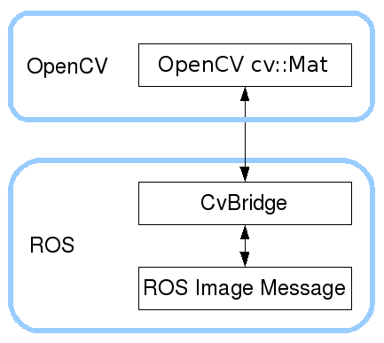

# cv_bridge

`cv_bridge` converts between ROS 2 image messages and [OpenCV](https://opencv.org/) images, in C++ and in Python.



## Usage

### C++

```cpp
#include "cv_bridge/cv_bridge.hpp"

void image_callback(const sensor_msgs::msg::Image::ConstSharedPtr & msg)
{
  // ROS image message to OpenCV image, converted to bgr8 if needed
  cv_bridge::CvImagePtr cv_ptr = cv_bridge::toCvCopy(msg, "bgr8");

  // cv_ptr->image is a cv::Mat
  cv::circle(cv_ptr->image, cv::Point(50, 50), 10, CV_RGB(255, 0, 0), 2);

  // OpenCV image to ROS image message
  sensor_msgs::msg::Image::SharedPtr out_msg = cv_ptr->toImageMsg();
}
```

```cmake
find_package(cv_bridge REQUIRED)
target_link_libraries(my_target PRIVATE cv_bridge::cv_bridge)
```

Use `cv_bridge::toCvShare()` instead of `toCvCopy()` to avoid copying the data when the image is not modified.
Both throw `cv_bridge::Exception` if the conversion is not possible.

### Python

```python
from cv_bridge import CvBridge

bridge = CvBridge()

# ROS image message to OpenCV image (a NumPy array), converted to bgr8 if needed
cv_image = bridge.imgmsg_to_cv2(msg, desired_encoding='bgr8')

# OpenCV image to ROS image message
out_msg = bridge.cv2_to_imgmsg(cv_image, encoding='bgr8', header=msg.header)
```

The methods raise `cv_bridge.CvBridgeError` if the conversion is not possible.

## Encodings

When a ROS image is converted to an OpenCV image, `cv_bridge` can convert between the grayscale and color encodings (`mono8`, `mono16`, `bgr8`, `rgb8`, `bgra8`, `rgba8`, ...), and from Bayer and YUV 4:2:2 images.
If no encoding is requested, the image keeps the encoding of the message.

Images with a generic encoding, like the `16UC1` and `32FC1` depth images, cannot be converted to a color encoding.
Use `cvtColorForDisplay()` to show them.

## Installation

`cv_bridge` is released as a binary package:

```console
sudo apt install ros-$ROS_DISTRO-cv-bridge
```

To build it from source, clone this repository into the `src` directory of a ROS 2 workspace, install its dependencies with `rosdep` and build it with `colcon`:

```console
cd <YOUR_ROS2_WORKSPACE>/src
git clone https://github.com/ros-perception/vision_opencv.git -b kilted
cd ..
rosdep install --from-paths src --ignore-src -y
colcon build --packages-up-to cv_bridge
```

The Python module needs Boost.Python. To build only the C++ library, add `--cmake-args -DCV_BRIDGE_DISABLE_PYTHON=ON`.

## Documentation

The full documentation, including tutorials and the API reference, is in the [doc](https://github.com/ros-perception/vision_opencv/tree/kilted/cv_bridge/doc) directory, and it is published at [docs.ros.org](https://docs.ros.org/en/rolling/p/cv_bridge/).
