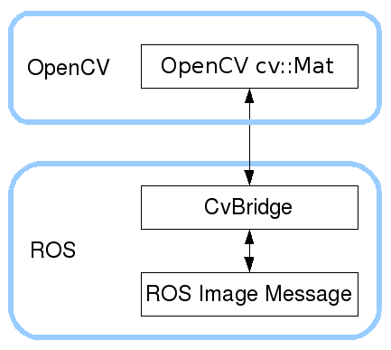

cv_bridge
=========

``cv_bridge`` converts between ROS 2 image messages and `OpenCV <https://opencv.org/>`_ images.

ROS 2 passes images around as ``sensor_msgs/msg/Image`` messages, but most of the code that processes images uses OpenCV.
``cv_bridge`` is the interface between both, in C++ and in Python:

.. toctree::
   :maxdepth: 2

   self
   tutorials
   references
   Package information </standards>

1. Encodings
------------

The ``encoding`` field of a ROS image message describes its pixels, and it determines the type of the OpenCV image.
The names of the encodings are defined in ``sensor_msgs/image_encodings.hpp``.

.. list-table::
   :header-rows: 1
   :widths: 35 20 45

   * - ROS encoding
     - OpenCV type
     - Description
   * - ``mono8``
     - ``CV_8UC1``
     - Grayscale image
   * - ``mono16``
     - ``CV_16UC1``
     - 16-bit grayscale image
   * - ``bgr8``, ``rgb8``
     - ``CV_8UC3``
     - Color image, with blue-green-red or red-green-blue color order
   * - ``bgra8``, ``rgba8``
     - ``CV_8UC4``
     - Color image with an alpha channel
   * - ``bgr16``, ``rgb16``, ``bgra16``, ``rgba16``
     - ``CV_16UC3``, ``CV_16UC4``
     - 16-bit color images
   * - ``bayer_rggb8``, ``bayer_bggr8``, ``bayer_gbrg8``, ``bayer_grbg8``
     - ``CV_8UC1``
     - Bayer pattern image. The 16-bit variants are ``CV_16UC1``.
   * - ``yuv422``, ``yuv422_yuy2``
     - ``CV_8UC2``
     - YUV 4:2:2 image, in UYVY or YUY2 order
   * - ``8UC1`` ... ``64FC4``
     - ``CV_8UC1`` ... ``CV_64FC4``
     - Generic encodings: a depth (``8U``, ``8S``, ``16U``, ``16S``, ``32S``, ``32F`` or ``64F``) and a number of channels.
       For example ``32FC1`` and ``16UC1`` are commonly used for depth images.

Note that ``mono8`` and ``bgr8`` are the two encodings expected by most OpenCV functions.

1.1 Conversions
~~~~~~~~~~~~~~~

When a ROS image is converted to an OpenCV image, a different encoding can be requested and ``cv_bridge`` converts the image if needed.
The supported conversions are:

* **No conversion.** If no encoding is requested, the OpenCV image has the encoding of the message.
* **Color conversions** between the grayscale and the color encodings (``mono``, ``bgr``, ``rgb``, ``bgra`` and ``rgba``).
* **From Bayer and YUV 4:2:2** images to grayscale and color images. Converting *to* these encodings is not supported.
* **Bit depth conversions** between the 8-bit and 16-bit variants of the encodings above. The values are scaled, so ``255`` becomes ``65535`` and the other way around.
* **To a generic encoding** with the same number of channels, from a generic or from a color encoding, for example from ``16UC1`` to ``32FC1`` or from ``bgr8`` to ``8UC3``.
  The values are scaled between 8 and 16 bits as above, and converted without scaling otherwise: ``1000`` stays ``1000`` from ``16UC1`` to ``32FC1``, but it becomes ``4`` from ``16UC1`` to ``8UC1``.

.. warning::

   The generic encodings do not describe the color of the pixels, so they cannot be converted to the color encodings.
   For example, a ``16UC1`` depth image cannot be converted to ``mono8``: the conversion fails with the error ``Cannot convert from [16UC1] to [mono8]: source encoding is not a known image format``.
   To show such an image use ``cvtColorForDisplay()``, see `4. Displaying images`_.

A conversion that is not supported, or a message with an unknown or malformed encoding, raises an exception: ``cv_bridge::Exception`` in C++ and ``cv_bridge.CvBridgeError`` in Python.
In C++, requesting an encoding that does not exist (for example a misspelled one) throws a ``std::runtime_error`` instead.

2. C++ API
----------

Add the dependency to your ``package.xml``:

.. code-block:: xml

   <depend>cv_bridge</depend>

and link against the exported target in your ``CMakeLists.txt``:

.. code-block:: cmake

   find_package(cv_bridge REQUIRED)

   add_executable(my_node src/my_node.cpp)
   target_link_libraries(my_node PRIVATE cv_bridge::cv_bridge)

The API is declared in ``cv_bridge/cv_bridge.hpp``.

2.1 CvImage
~~~~~~~~~~~

:cpp:class:`cv_bridge::CvImage` contains an OpenCV image, its encoding and a ROS header.
This is exactly the information of a ``sensor_msgs/msg/Image`` message, so either representation can be converted to the other.

.. code-block:: C++

   class CvImage
   {
   public:
     std_msgs::msg::Header header;
     std::string encoding;
     cv::Mat image;
   };

   typedef std::shared_ptr<CvImage> CvImagePtr;
   typedef std::shared_ptr<CvImage const> CvImageConstPtr;

2.2 Converting ROS image messages to OpenCV images
~~~~~~~~~~~~~~~~~~~~~~~~~~~~~~~~~~~~~~~~~~~~~~~~~~

There are two use cases, with a function for each of them:

.. code-block:: C++

   // Case 1: Always copy, returning a mutable CvImage
   CvImagePtr toCvCopy(
     const sensor_msgs::msg::Image::ConstSharedPtr & source,
     const std::string & encoding = std::string());
   CvImagePtr toCvCopy(
     const sensor_msgs::msg::Image & source,
     const std::string & encoding = std::string());

   // Case 2: Share if possible, returning a const CvImage
   CvImageConstPtr toCvShare(
     const sensor_msgs::msg::Image::ConstSharedPtr & source,
     const std::string & encoding = std::string());
   CvImageConstPtr toCvShare(
     const sensor_msgs::msg::Image & source,
     const std::shared_ptr<void const> & tracked_object,
     const std::string & encoding = std::string());

``toCvCopy()``
  Copies the image data of the message, even when the source and the destination encodings match.
  You are free to modify the returned ``CvImage``.

``toCvShare()``
  Points the returned ``cv::Mat`` at the data of the message, without copying it, if the source and the destination encodings match.
  The message is not freed as long as you hold a copy of the returned ``CvImage``.
  If the encodings do not match, a new buffer is allocated and the image is converted.
  You must not modify the returned ``CvImage``, because it may share its data with the message, which in turn may be shared with other callbacks.

  The second overload is convenient when you have a pointer to some other message that contains the ``sensor_msgs/msg/Image`` to convert, like a ``stereo_msgs/msg/DisparityImage``.

If ``encoding`` is the empty string, the image keeps the encoding of the message, and ``toCvShare()`` does not copy the data.
The only exception is a message whose byte order (``is_bigendian``) is not the one of the computer, which is always copied.

Compressed images can be converted too.
``toCvCopy()`` also accepts a ``sensor_msgs/msg/CompressedImage`` message, which it decodes with OpenCV.

2.3 Converting OpenCV images to ROS image messages
~~~~~~~~~~~~~~~~~~~~~~~~~~~~~~~~~~~~~~~~~~~~~~~~~~

Use the member functions of ``CvImage``:

.. code-block:: C++

   class CvImage
   {
     sensor_msgs::msg::Image::SharedPtr toImageMsg() const;

     // Overload mainly intended for aggregate messages that contain
     // a sensor_msgs::msg::Image as a member.
     void toImageMsg(sensor_msgs::msg::Image & ros_image) const;

     // Compress the image, as JPEG by default
     sensor_msgs::msg::CompressedImage::SharedPtr toCompressedImageMsg(
       const Format dst_format = JPG) const;
   };

The image is not converted: the message has the ``encoding`` of the ``CvImage``.
It must match the type of its ``cv::Mat``, which is not checked.
If the ``CvImage`` is one you have created yourself, do not forget to fill in the ``header`` and ``encoding`` fields:

.. code-block:: C++

   cv::Mat image = ...;  // a CV_8UC3 image in BGR order
   std_msgs::msg::Header header;
   header.stamp = now();
   header.frame_id = "camera";

   sensor_msgs::msg::Image::SharedPtr msg =
     cv_bridge::CvImage(header, "bgr8", image).toImageMsg();

To change the encoding of a ``CvImage`` use ``cv_bridge::cvtColor()``, which follows the same rules as ``toCvCopy()``.

3. Python API
-------------

The Python API is the :class:`cv_bridge.CvBridge` class.
OpenCV images are NumPy arrays in Python:

.. code-block:: python

   from cv_bridge import CvBridge

   bridge = CvBridge()

   # ROS image message to OpenCV image
   cv_image = bridge.imgmsg_to_cv2(image_message, desired_encoding='passthrough')

   # OpenCV image to ROS image message
   image_message = bridge.cv2_to_imgmsg(cv_image, encoding='passthrough')

``imgmsg_to_cv2()``
  With the default ``'passthrough'`` the image keeps the encoding of the message.
  Any other encoding converts the image, see `1.1 Conversions`_.
  Images with one channel are returned as two-dimensional arrays.

``cv2_to_imgmsg()``
  Does not convert the image: ``encoding`` only tells the consumers of the message how to interpret the data, and it must be compatible with the type of the array.
  With ``'passthrough'`` the message gets the generic encoding of the array, like ``8UC3``, which loses the color order.
  Pass ``'bgr8'`` or ``'rgb8'`` for color images, and use ``cv2.cvtColor()`` first if the image has to be converted.
  The optional ``header`` argument sets the header of the message.

``compressed_imgmsg_to_cv2()`` and ``cv2_to_compressed_imgmsg()``
  Do the same for ``sensor_msgs/msg/CompressedImage`` messages.

The methods raise ``cv_bridge.CvBridgeError`` when a conversion is not possible.

4. Displaying images
--------------------

``cvtColorForDisplay()`` converts an image to an 8-bit grayscale or color image that can be shown on screen, using practical rules for the encodings that have no color information:

* Images with a color or grayscale encoding are converted to the output encoding.
* Images with one channel, like depth images, can be scaled to the range of the output: between their minimum and maximum values (``do_dynamic_scaling``) or between two given values (``min_image_value`` and ``max_image_value``). A color map can be applied too (``colormap``).
  Scaling is the way to display ``32FC1`` and ``8UC1`` images, which fail otherwise. ``16UC1`` images are also accepted without scaling.
* ``32SC1`` images are interpreted as label images, and every label gets a different color.

Images with a generic encoding of more than one channel, like ``8UC3``, are not supported.

It is available in C++ (with ``cv_bridge::CvtColorForDisplayOptions``) and in Python:

.. code-block:: python

   import cv_bridge

   # depth_image is a NumPy array with the 32FC1 encoding
   display_image = cv_bridge.cvtColorForDisplay(
       depth_image, '32FC1', 'bgr8', do_dynamic_scaling=True)

5. Publishing cv::Mat directly
------------------------------

In C++, ``cv_bridge`` provides a `type adapter <https://ros.org/reps/rep-2007.html>`_ to publish and subscribe to ``cv::Mat`` images directly, without converting them to a message in your code.
With intra-process communication, the images are passed between the nodes of a process without copying them.

The adapted type is :cpp:class:`cv_bridge::ROSCvMatContainer`, declared in ``cv_bridge/cv_mat_sensor_msgs_image_type_adapter.hpp``.
See the :doc:`Tutorials/Using-Type-Adaptation-Cpp` tutorial.

6. Building without Python
--------------------------

The Python module needs Boost.Python.
To build only the C++ library, set the ``CV_BRIDGE_DISABLE_PYTHON`` CMake option:

.. code-block:: console

   $ colcon build --packages-select cv_bridge --cmake-args -DCV_BRIDGE_DISABLE_PYTHON=ON
