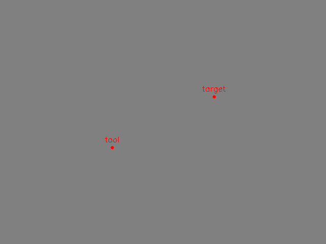

Projecting a TF frame onto an image (C++)
-----------------------------------------

Overview
~~~~~~~~

This tutorial shows how to use ``image_geometry`` together with ``tf2`` to project TF frames onto a live image stream.
The node of this tutorial draws the position of one or more frames on every image, and publishes the annotated images:

Although this is a mathematically simple operation, this tutorial integrates several components that you will use frequently when you write vision code with ROS 2: OpenCV, ``tf2``, ``image_transport``, ``cv_bridge`` and ``image_geometry``.

Prerequisites
~~~~~~~~~~~~~

This tutorial assumes you have a working knowledge of ROS 2, of `tf2 <https://docs.ros.org/en/rolling/p/tf2_ros/>`_ and of `cv_bridge <https://docs.ros.org/en/rolling/p/cv_bridge/>`_.

If you have not done so already `create a workspace <https://docs.ros.org/en/rolling/ROS-Framework/client-libraries/Working-with-Client-Libraries/Creating-A-Workspace/Creating-A-Workspace.html>`_ and `create a package <https://docs.ros.org/en/rolling/ROS-Framework/client-libraries/Working-with-Client-Libraries/Creating-Your-First-ROS2-Package.html>`_.

1. Write the node
~~~~~~~~~~~~~~~~~

Let's assume you have already created an empty ROS 2 package for C++ named ``image_geometry_tutorial``.
Create a new file ``src/draw_frames.cpp`` inside your package, with the following content:

.. code-block:: C++

  #include <memory>
  #include <string>
  #include <vector>

  #include "cv_bridge/cv_bridge.hpp"
  #include "image_geometry/pinhole_camera_model.hpp"
  #include "image_transport/image_transport.hpp"
  #include "opencv2/imgproc.hpp"
  #include "rclcpp/rclcpp.hpp"
  #include "sensor_msgs/image_encodings.hpp"
  #include "tf2/exceptions.hpp"
  #include "tf2_ros/buffer.hpp"
  #include "tf2_ros/transform_listener.hpp"

  class FrameDrawer : public rclcpp::Node
  {
  public:
    FrameDrawer()
    : Node("draw_frames"),
      tf_buffer_(get_clock()),
      tf_listener_(tf_buffer_)
    {
      frame_ids_ = declare_parameter("frames", std::vector<std::string>{});

      subscriber_ = image_transport::create_camera_subscription(
        *this, "image",
        [this](
          const sensor_msgs::msg::Image::ConstSharedPtr & image_msg,
          const sensor_msgs::msg::CameraInfo::ConstSharedPtr & info_msg) {
          image_callback(image_msg, info_msg);
        },
        "raw", rclcpp::SensorDataQoS());

      publisher_ = image_transport::create_publisher(*this, "image_out", rclcpp::QoS(10));
    }

  private:
    void image_callback(
      const sensor_msgs::msg::Image::ConstSharedPtr & image_msg,
      const sensor_msgs::msg::CameraInfo::ConstSharedPtr & info_msg)
    {
      cv_bridge::CvImagePtr cv_ptr;
      try {
        cv_ptr = cv_bridge::toCvCopy(image_msg, sensor_msgs::image_encodings::BGR8);
      } catch (const cv_bridge::Exception & e) {
        RCLCPP_ERROR(get_logger(), "Failed to convert image: %s", e.what());
        return;
      }

      cam_model_.fromCameraInfo(info_msg);

      for (const std::string & frame_id : frame_ids_) {
        geometry_msgs::msg::TransformStamped transform;
        try {
          transform = tf_buffer_.lookupTransform(
            cam_model_.tfFrame(), frame_id, info_msg->header.stamp,
            rclcpp::Duration::from_seconds(1.0 / 30));
        } catch (const tf2::TransformException & e) {
          RCLCPP_WARN_THROTTLE(get_logger(), *get_clock(), 1000, "TF exception: %s", e.what());
          continue;
        }

        const cv::Point3d point(
          transform.transform.translation.x,
          transform.transform.translation.y,
          transform.transform.translation.z);
        if (point.z <= 0.0) {
          // The frame is behind the camera
          continue;
        }
        const cv::Point2d uv = cam_model_.project3dToPixel(point);

        static constexpr int kRadius = 3;
        cv::circle(cv_ptr->image, uv, kRadius, CV_RGB(255, 0, 0), -1);

        int baseline = 0;
        const cv::Size text_size = cv::getTextSize(
          frame_id, cv::FONT_HERSHEY_SIMPLEX, 0.5, 1, &baseline);
        const cv::Point origin(
          static_cast<int>(uv.x) - text_size.width / 2,
          static_cast<int>(uv.y) - kRadius - baseline - 3);
        cv::putText(
          cv_ptr->image, frame_id, origin, cv::FONT_HERSHEY_SIMPLEX, 0.5, CV_RGB(255, 0, 0));
      }

      publisher_.publish(cv_ptr->toImageMsg());
    }

    std::vector<std::string> frame_ids_;
    image_geometry::PinholeCameraModel cam_model_;
    tf2_ros::Buffer tf_buffer_;
    tf2_ros::TransformListener tf_listener_;
    image_transport::CameraSubscriber subscriber_;
    image_transport::Publisher publisher_;
  };

  int main(int argc, char ** argv)
  {
    rclcpp::init(argc, argv);
    rclcpp::spin(std::make_shared<FrameDrawer>());
    rclcpp::shutdown();
    return 0;
  }

2. Examine the code
~~~~~~~~~~~~~~~~~~~

.. code-block:: C++

  #include "image_geometry/pinhole_camera_model.hpp"

This header declares the ``PinholeCameraModel`` class, which the node uses to project a 3D point to image coordinates.

.. code-block:: C++

      frame_ids_ = declare_parameter("frames", std::vector<std::string>{});

The frames to draw are given in the ``frames`` parameter.

.. code-block:: C++

      subscriber_ = image_transport::create_camera_subscription(
        *this, "image",

When processing data from a calibrated camera, both the image and the ``CameraInfo`` message, which contains the calibration, are needed.
A camera subscription of ``image_transport`` subscribes to the ``image`` topic and to its sibling ``camera_info`` topic, and it calls the callback with the two messages that have the same time stamp.

.. code-block:: C++

      cam_model_.fromCameraInfo(info_msg);

Fill the ``PinholeCameraModel`` with the calibration.
``cam_model_`` is a member variable rather than a local one: in the common case that the calibration does not change, updating a previously filled camera model is very cheap.

.. code-block:: C++

        transform = tf_buffer_.lookupTransform(
          cam_model_.tfFrame(), frame_id, info_msg->header.stamp,
          rclcpp::Duration::from_seconds(1.0 / 30));

For each requested frame, query ``tf2`` for its position in the optical frame of the camera, ``cam_model_.tfFrame()``, which is the ``frame_id`` of the ``CameraInfo``.

For maximal accuracy, the transform is looked up at the time the image was acquired, rather than the latest one.
The node assumes the camera is streaming at 30 fps, so it is willing to wait no more than 1/30 s for the transform to become available.

.. code-block:: C++

      if (point.z <= 0.0) {
        // The frame is behind the camera
        continue;
      }
      const cv::Point2d uv = cam_model_.project3dToPixel(point);

Take the origin of the frame in the optical frame of the camera, and project it to image coordinates.
The points that are behind the camera (with a negative ``z``) would be projected to meaningless coordinates, so they are skipped.

The node assumes it is listening to a *rectified* image topic.
The raw images of a camera driver are typically distorted, which prevents a clean projective mapping from 3D coordinates to image coordinates.
In ROS 2 the distortion is usually removed by an ``image_proc`` node between the camera driver and your node, see `3. Raw and rectified images <../index.html#raw-and-rectified-images>`_.

.. code-block:: C++

      cv::circle(cv_ptr->image, uv, kRadius, CV_RGB(255, 0, 0), -1);

Finally, draw a filled red circle at the position of the frame, print its name centered above it, and publish the annotated image.

3. Update package.xml and CMakeLists.txt
~~~~~~~~~~~~~~~~~~~~~~~~~~~~~~~~~~~~~~~~

Add the dependencies to your ``package.xml``:

.. code-block:: xml

  <depend>cv_bridge</depend>
  <depend>image_geometry</depend>
  <depend>image_transport</depend>
  <depend>libopencv-dev</depend>
  <depend>rclcpp</depend>
  <depend>sensor_msgs</depend>
  <depend>tf2</depend>
  <depend>tf2_ros</depend>

Add the executable to your ``CMakeLists.txt``:

.. code-block:: cmake

  find_package(ament_cmake REQUIRED)
  find_package(cv_bridge REQUIRED)
  find_package(image_geometry REQUIRED)
  find_package(image_transport REQUIRED)
  find_package(OpenCV REQUIRED COMPONENTS core imgproc)
  find_package(rclcpp REQUIRED)
  find_package(sensor_msgs REQUIRED)
  find_package(tf2 REQUIRED)
  find_package(tf2_ros REQUIRED)

  add_executable(draw_frames src/draw_frames.cpp)
  target_compile_features(draw_frames PUBLIC cxx_std_17)
  target_link_libraries(draw_frames PRIVATE
    cv_bridge::cv_bridge
    image_geometry::image_geometry
    image_transport::image_transport
    opencv_core
    opencv_imgproc
    rclcpp::rclcpp
    ${sensor_msgs_TARGETS}
    tf2::tf2
    tf2_ros::tf2_ros)

  install(TARGETS draw_frames
    DESTINATION lib/${PROJECT_NAME})

  ament_package()

Build your package from the root of your workspace and source it:

.. code-block:: console

  $ colcon build --packages-select image_geometry_tutorial
  $ source install/setup.bash

4. Start a camera
~~~~~~~~~~~~~~~~~

The node needs a calibrated camera that publishes an ``image`` and a ``camera_info`` topic, like a camera driver or a bag.
If you do not have one, this script simulates an ideal camera that publishes gray images, with the optical frame ``camera_optical_frame``.
Save it as ``simulated_camera.py``:

.. code-block:: python

  import numpy as np
  import rclpy
  from rclpy.node import Node
  from sensor_msgs.msg import CameraInfo, Image

  class SimulatedCamera(Node):
      """Publish a gray image and the calibration of an ideal 640x480 camera."""

      def __init__(self):
          super().__init__('simulated_camera')
          self.image_pub = self.create_publisher(Image, 'camera/image', 10)
          self.info_pub = self.create_publisher(CameraInfo, 'camera/camera_info', 10)
          self.create_timer(0.1, self.publish)

      def publish(self):
          stamp = self.get_clock().now().to_msg()

          info = CameraInfo()
          info.header.stamp = stamp
          info.header.frame_id = 'camera_optical_frame'
          info.width, info.height = 640, 480
          info.distortion_model = 'plumb_bob'
          info.d = [0.0, 0.0, 0.0, 0.0, 0.0]
          info.k = [500.0, 0.0, 320.0, 0.0, 500.0, 240.0, 0.0, 0.0, 1.0]
          info.r = [1.0, 0.0, 0.0, 0.0, 1.0, 0.0, 0.0, 0.0, 1.0]
          info.p = [500.0, 0.0, 320.0, 0.0, 0.0, 500.0, 240.0, 0.0, 0.0, 0.0, 1.0, 0.0]

          image = Image()
          image.header = info.header
          image.width, image.height = info.width, info.height
          image.encoding = 'mono8'
          image.step = image.width
          image.data = np.full(image.width * image.height, 128, np.uint8).tobytes()

          self.image_pub.publish(image)
          self.info_pub.publish(info)

  def main():
      rclpy.init()
      rclpy.spin(SimulatedCamera())
      rclpy.shutdown()

  if __name__ == '__main__':
      main()

And run it in a terminal:

.. code-block:: console

  $ python3 simulated_camera.py

5. Publish some frames
~~~~~~~~~~~~~~~~~~~~~~

The node draws the frames that ``tf2`` knows about.
On a robot they come from its ``robot_state_publisher`` and other nodes.
For this tutorial, publish two static frames in front of the camera, each in its own terminal:

.. code-block:: console

  $ ros2 run tf2_ros static_transform_publisher --x 0.2 --y -0.1 --z 1.0 --frame-id camera_optical_frame --child-frame-id target

.. code-block:: console

  $ ros2 run tf2_ros static_transform_publisher --x -0.3 --y 0.15 --z 1.5 --frame-id camera_optical_frame --child-frame-id tool

6. Run the node
~~~~~~~~~~~~~~~

Run the node, remapping its ``image`` topic to the image topic of the camera and giving it the frames to draw:

.. code-block:: console

  $ ros2 run image_geometry_tutorial draw_frames --ros-args -r image:=/camera/image -p "frames:=[target, tool]"

The ``camera_info`` topic is found automatically next to the image topic, so here it is ``/camera/camera_info``.

See the annotated images with ``rqt_image_view``:

.. code-block:: console

  $ ros2 run rqt_image_view rqt_image_view /image_out

The ``target`` frame, 0.2 m to the right and 0.1 m above the optical axis at 1 m, is drawn at the pixel ``(420, 190)``: 100 and 50 pixels from the center of the image, since the focal length of the simulated camera is 500 pixels.

If one of the frames does not exist, the node prints a warning and draws the others:

.. code-block:: console

  [WARN] [draw_frames]: TF exception: "missing" passed to lookupTransform argument source_frame does not exist.

The time stamps of the log messages are omitted here.
